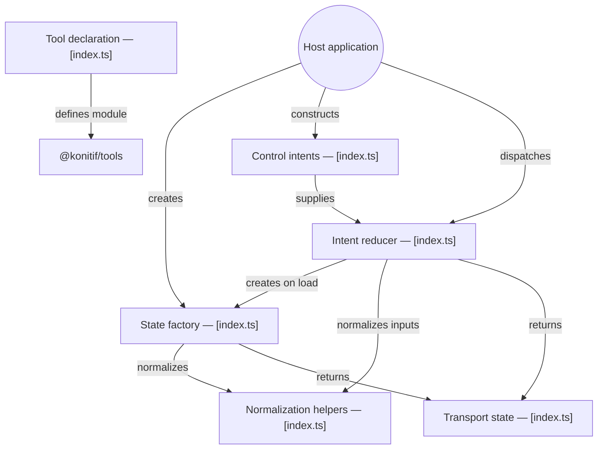

# GitDiagram architecture — @konitif/transport-controls

This architecture view was generated from the public repository by [GitDiagram](https://gitdiagram.com/lemouf/konitif-transport-controls) on 2026-09-20 18:46:12 UTC.

It is a documentation projection of the repository tree, README, and source files sampled by GitDiagram. It does not replace the authored contracts in [catalog.json](catalog.json) and [diagrams.json](diagrams.json), nor does it establish runtime authority.

The Mermaid source keeps GitDiagram's groups, nodes, relationships, and source links. GitDiagram's forced color classes and HTML line breaks are omitted so the diagram remains readable in local previews and dark themes.

- Public repository: [konitif-transport-controls](https://github.com/LeMouf/konitif-transport-controls)
- Interactive diagram: [Open in GitDiagram](https://gitdiagram.com/lemouf/konitif-transport-controls)

## Architecture diagram

## Generated analysis

@konitif/transport-controls is a small pure TypeScript state machine. A host creates normalized transport state, constructs an explicit control intent, and passes both to the reducer, which returns the next deterministic state. The module covers loading, playback phase, seeking, ranges, rate, and looping; it does not own media, clocks, schedulers, stores, or playback effects. The sampled implementation is concentrated in src/index.ts; build, release, tests, and reference metadata are excluded.
